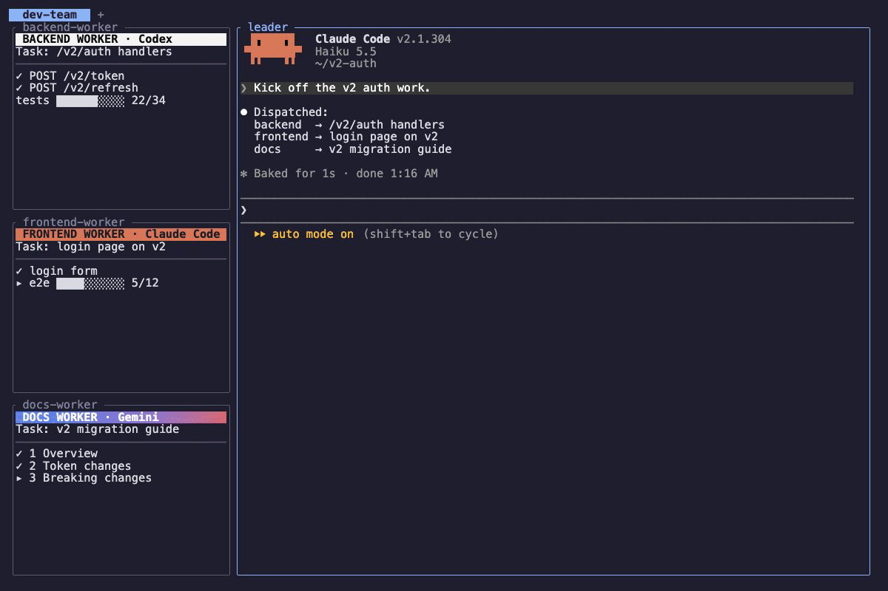
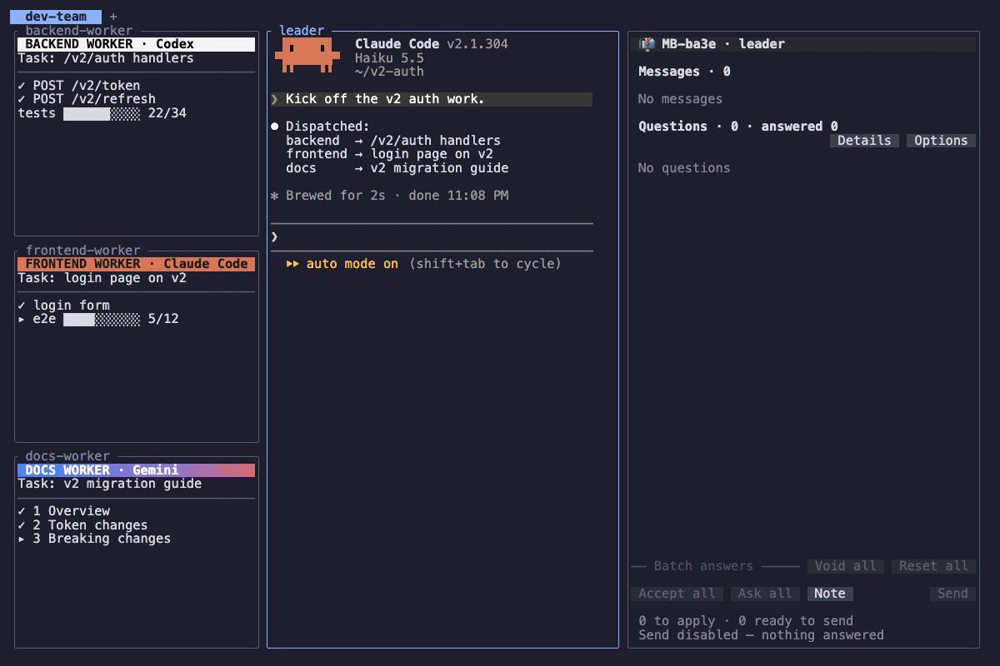
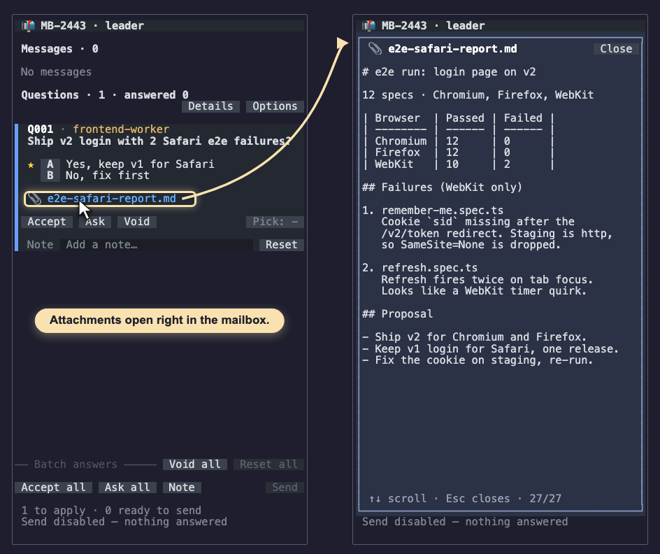

# herdr-mailbox


[English](./README.md) | [简体中文](./docs/zh-sc.md) | [繁體中文](./docs/zh-tc.md) | [Español](./docs/es.md) | [Português](./docs/pt.md) | [Русский](./docs/ru.md) | [日本語](./docs/jp.md) | [Français](./docs/fr.md) | [Deutsch](./docs/de.md) | [Tiếng Việt](./docs/vi.md) | [한국어](./docs/ko.md) | [ไทย](./docs/th.md) | [Italiano](./docs/it.md)

<p align="center">
  <a href="#install">install</a> · <a href="#sending-a-letter">sending a letter</a> · <a href="#limits">limits</a> · <a href="docs/guide.md">full guide</a>
</p>

> You're typing, a worker cuts in, the leader wakes up for the third time, and where did that question go?

You run a multi-agent workflow in Herdr: one leader, a few workers on Claude Code and Codex, each on its own job. Every time one of them finishes something, it drops it into the leader's conversation. You're halfway through a sentence and a report cuts in and goes out with it; the decision question you were just asked is washed away by the next message.

**Before**



Mailbox gives the leader a mailbox. Workers can drop in plain notes, like postcards, and also decision cards and discussion cards for you to answer. Notes go in as one batch, only when you are not typing and the leader is free; cards wait in the mailbox until you answer them with the mouse.

**After**



- **Your input box stays yours** — nothing is typed while you are typing, and nothing lands while the leader is still answering.
- **Notes arrive together** — notes wait up to a minute so they can go in as one batch and wake the leader once; **Send now** skips the wait.
- **Questions in one place** — decision questions become cards beside the leader; answer with the mouse and send every answer in one batch.
- **Any agent can write** — senders only run `mailbox send`, so Claude Code, Codex and any agent that can run a shell command can write to the same mailbox.
- **A receipt for every send** — each send returns at once with the letter's id and status.
- **It follows the leader** — moving the pane, restarting Herdr or clearing the conversation keeps the mailbox with the same receiver.

## Install

Requires Herdr 0.9.3 or newer and Node 18 or newer.

```sh
herdr plugin install navishachiku/herdr-mailbox
```

Then hand the rest of the setup (the `mailbox` command, the Claude Code hooks, the shortcut, and Codex if you use it) to your coding agent. Paste this to it:

```
Set up herdr-mailbox by following https://github.com/navishachiku/herdr-mailbox/blob/main/AGENT-SETUP.md
```

When it is done, reload Herdr with `prefix+shift+r` and press `prefix+shift+m` on the leader's pane to open the mailbox screen beside it (`prefix` is `ctrl+b` unless you changed it). The steps the agent follows are in [AGENT-SETUP.md](AGENT-SETUP.md).

## Sending a letter

```sh
mailbox send --to <address|MB-id> --type note "tests pass"

mailbox send --to <address|MB-id> --type decision \
  --question "Install the skill too?" --option "Yes" --option "No" --recommend A
```

Longer material goes with the letter as a file (`--attach <file>`); the card shows a link, and the file opens right inside the mailbox screen.



`--to` takes a pane id, an agent name or a mailbox id. Press `prefix+shift+m` on the leader's pane to open the mailbox screen beside it. Discussion questions, editing and withdrawing letters, and every screen button are in [the full guide](docs/guide.md).

## Limits

- A question is up to 200 characters and a note up to 500; longer text goes in a file with `--attach`.
- The agent that owns the mailbox (the leader) has to be Claude Code, because delivery waits until its input box is empty; senders can be any agent.

<details>
<summary>Advanced: how it works, state, tests</summary>

### How it works

A small daemon owns the state file and handles one request at a time. The CLI talks to it over a local socket and starts it when it is not running. State lives under Herdr's plugin state directory, outside the plugin code directory, with a schema version, and is written to disk before a receipt is returned. Each Herdr session gets its own subdirectory, daemon and mailboxes, so the same pane address in two sessions never shares letters.

| Piece | Role |
| --- | --- |
| `src/daemon.mjs`, `src/core.mjs` | The daemon and the letter rules: receipts, deduplication, edit and withdraw, limits. |
| `src/identity.mjs` | Binding a mailbox to a receiver, the reconcile loop, claims. |
| `src/delivery.mjs`, `src/format.mjs`, `src/input-box.mjs` | Batching, the input-box check, confirmation, batch text. |
| `src/screen/` | The mailbox screen, with settings and attachments shown inside it. |
| `src/open.mjs`, `src/on-focus.mjs` | The `prefix+shift+m` action and reopening the screen after a Herdr restart. |
| `src/session-start.mjs`, `src/prompt-submit.mjs`, `src/send-guard.mjs` | The Claude Code hooks. |

### Tests

```sh
npm test
```

Runs the real CLI and daemon against a fake `herdr` binary in a throwaway state directory.

</details>

## License

MIT
