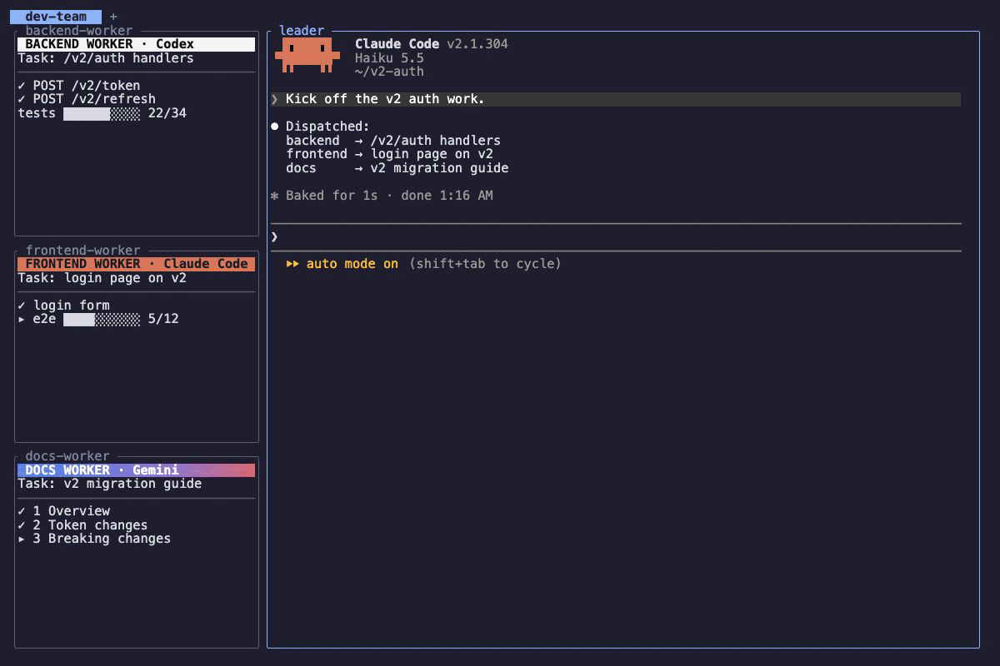
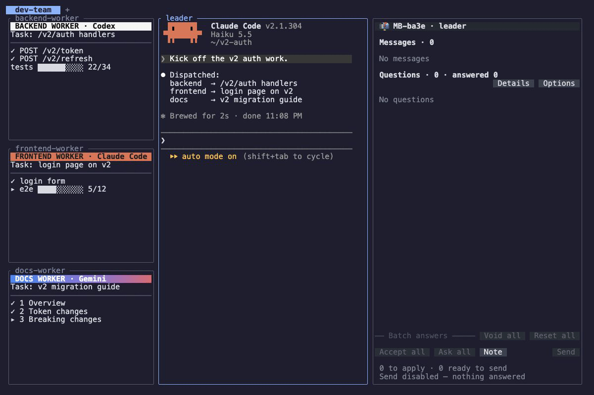

# herdr-mailbox


[English](../README.md) | [简体中文](./zh-sc.md) | [繁體中文](./zh-tc.md) | [Español](./es.md) | [Português](./pt.md) | [Русский](./ru.md) | [日本語](./jp.md) | [Français](./fr.md) | [Deutsch](./de.md) | [Tiếng Việt](./vi.md) | [한국어](./ko.md) | [ไทย](./th.md) | [Italiano](./it.md)

<p align="center">
  <a href="#installation">installation</a> · <a href="#utilisation">utilisation</a> · <a href="#envoyer-un-courrier">envoyer un courrier</a> · <a href="#limites">limites</a> · <a href="./guide.md">guide complet</a>
</p>

> Dans un multi-agent workflow, ce qui compte le plus, c'est ton attention et tes décisions.

Tu fais tourner un multi-agent workflow dans Herdr : un agent leader et plusieurs agents worker, chacun sur sa tâche. Leurs rapports et leurs messages submergent la conversation du leader. Tu n'as écrit que la moitié d'une phrase et un rapport s'y glisse et part avec ; la question de décision qu'on venait de te poser est noyée une seconde plus tard par le message suivant.

Ce plugin existe précisément pour régler ça : ton attention n'est plus interrompue et reste réservée aux décisions de qualité que toi seul peux prendre.

Ce n'est pas une nouvelle version des questions à options de Claude Code (AskUserQuestion). Il s'appuie sur ce que propose Herdr pour réunir au même endroit les rapports et les questions en attente d'agents de différents éditeurs, les regrouper et les coordonner ; et comme la conversation n'est plus submergée, il économise aussi l'usage que ces flots auraient coûté.

**Avant**



Mailbox donne une boîte aux lettres au leader. Les workers y déposent des messages ordinaires, comme des cartes postales ; les cartes de décision et de discussion auxquelles tu réponds sont déposées par le leader lui-même, et chaque carte dit d'où vient sa question. Les messages ordinaires arrivent en un seul lot, uniquement quand tu ne tapes pas et que le leader est libre ; les cartes attendent dans la boîte que tu y répondes à la souris.

**Après**



- **Ta zone de saisie reste à toi** — rien n'y est tapé pendant que tu écris, et rien n'arrive tant que le leader est en train de répondre.
- **Les messages arrivent ensemble** — les messages ordinaires attendent jusqu'à une minute pour partir en un seul lot et ne réveiller le leader qu'une fois ; **Envoyer** évite l'attente.
- **Les questions au même endroit** — les questions de décision deviennent des cartes à côté du leader, chacune indiquant d'où vient la question ; réponds à la souris et toutes les réponses repartent en un seul lot.
- **N'importe quel agent peut écrire** — l'expéditeur n'a qu'à lancer `mailbox send`, donc Claude Code, Codex, agy et tout agent capable d'exécuter une commande shell écrivent dans la même boîte.
- **Un accusé de réception pour chaque envoi** — chaque envoi renvoie aussitôt l'id et le statut de la lettre.
- **Elle suit le leader** — déplacer le pane, redémarrer Herdr ou vider la conversation, la boîte reste attachée au même destinataire.

## Installation

Nécessite Herdr 0.9.3 ou plus récent et Node 18 ou plus récent.

```sh
# 1. Installer le plugin
herdr plugin install navishachiku/herdr-mailbox

# 2. Lancer son action setup : la commande `mailbox`, les hooks de Claude Code, les règles d'autorisation de Codex et d'agy, et les gardes d'envoi de Codex et d'agy
herdr plugin action invoke setup --plugin herdr-mailbox

# 3. Les intégrations d'agents propres à Herdr, une pour chaque agent que tu utilises
herdr integration install claude
herdr integration install codex
herdr integration install antigravity-cli

# 4. La skill qui apprend aux agents à envoyer des lettres
npx skills add navishachiku/herdr-mailbox --global
```

Pour une installation non interactive du plugin, ajoute `--yes` à l'étape 1 : `herdr plugin install navishachiku/herdr-mailbox --yes`.

Les intégrations de Herdr identifient la conversation de chaque pane pour que la boîte puisse se lier à son destinataire. Si le mode automatique d'un agent refuse l'étape 3, lance toi-même les commandes concernées dans un terminal. Sans l'intégration, l'envoi peut encore fonctionner, mais la boîte risque de ne pas pouvoir se lier à la conversation du destinataire.

Un agent sans système de skills peut lire les mêmes instructions avec `mailbox skill` ; colle sa sortie dans le fichier d'instructions de cet agent.

L'action setup sauvegarde chaque fichier avant de le modifier (`<file>.bak-<date>`), n'ajoute rien deux fois quand on la relance et continue de fonctionner après `herdr plugin update`. `node <plugin dir>/src/setup.mjs uninstall` l'annule. Redémarre les sessions Claude Code qui doivent recevoir du courrier. Codex demande une fois, à l'écran, de faire confiance au nouveau hook.

Après `herdr plugin update`, relance une fois l'action setup : les hooks de Claude Code ne sont réécrits que par setup, et une version qui ajoute une source d'événement (par exemple `fork`, qui permet à la boîte de continuer à confirmer quand un destinataire passe sa conversation en arrière-plan) n'atteint une machine déjà installée que de cette façon.

Ajoute le raccourci au `config.toml` de Herdr (`~/.config/herdr/config.toml` ; sous Windows `%APPDATA%\herdr\config.toml`), puis recharge avec `prefix+shift+r` (`prefix` vaut `ctrl+b`, sauf si tu l'as changé) :

```toml
[[keys.command]]
key = "prefix+shift+m"
type = "plugin_action"
command = "herdr-mailbox.open"
description = "open the mailbox"

[ui.toast]
delivery = "herdr"
```

Si l'action ne fonctionne pas sur ta machine, [AGENT-SETUP.md](../AGENT-SETUP.md) reprend les mêmes étapes pour qu'un coding agent les suive.

## Utilisation

Ouvre la boîte dans la fenêtre du leader : sélectionne le pane du leader et appuie sur `prefix+shift+m`. La boîte appartient à l'agent du pane sur lequel tu appuies, donc appuie dans celui du leader, pas dans celui d'un worker. L'écran de la boîte s'ouvre à côté du leader ; appuyer de nouveau sur le raccourci depuis l'écran, ou sur `q`, le ferme, et les lettres restent.

- **Messages** — les messages ordinaires des workers attendent ici et partent vers le leader en un seul lot ; **Envoyer** les envoie tout de suite.
- **Questions** — cartes de décision et de discussion. Clique sur une option ou écris une note, puis **Envoyer** renvoie toutes les réponses en un seul lot. **Tout accepter**, **Tout demander** et **Tout annuler** agissent sur plusieurs cartes à la fois.
- **Options** — largeur de l'écran, mode des cartes, durée d'attente des messages avant regroupement et langue de l'écran (13 langues).

Quand l'écran n'est pas ouvert, une nouvelle question de décision ou de discussion déclenche une notification Herdr avec la question ; écran ouvert, aucune notification n'est envoyée. Les workers écrivent au leader avec `mailbox send`, décrit ci-dessous.

**Reprendre une boîte** : quand la conversation du leader est remplacée, la boîte se déconnecte et ses lettres restent. Lance dans le pane du nouvel agent la ligne `mailbox claim MB-xxxx` affichée à l'écran, et la boîte est de nouveau connectée. Si tu passes la boîte à un successeur volontairement, lance d'abord `mailbox release` dans le pane du destinataire actuel : la boîte se déconnecte aussitôt, et le successeur n'attend pas que ce pane soit jugé disparu (environ 20 secondes). Avec `--next <pane ou nom d'agent>`, tu désignes le pane du successeur : les notes envoyées à ce pane attendent dans cette boîte jusqu'à ce qu'elle soit reprise, au lieu d'être tapées dans un pane dont l'agent démarre encore.

**Renouveler une boîte** : pour repartir de zéro avec un nouvel identifiant plutôt que de traîner un long historique, lance `mailbox renew` dans le pane du destinataire, ou clique sur **Renouveler** en haut de l'écran. Le pane reçoit un nouvel identifiant de boîte et l'écran passe dessus. Les messages et questions pas encore envoyés, brouillons compris, suivent ; l'historique des lots reste avec l'ancien identifiant. Les lettres adressées à un ancien identifiant sont redirigées pour toujours vers la boîte la plus récente, et l'accusé de l'expéditeur indique que l'identifiant a changé.

**Pendant ton absence** : le destinataire lance `mailbox away on` dans son pane ; les cartes arrivent toujours mais ne déclenchent aucune notification. `mailbox away off` déclenche une seule notification pour les cartes arrivées entre-temps et toujours en attente.

## Envoyer un courrier

```sh
mailbox send --to <address|MB-id> --type note "tests pass"

mailbox send --to <address|MB-id> --type decision \
  --question "Install the skill too?" --option "Yes" --option "No" \
  --tradeoff "Agents can send letters; one more skill to keep updated" \
  --tradeoff "Nothing new to maintain; agents must be told by hand" \
  --why-open "No rule says whether agents get the skill" --recommend A \
  --source-uid <uid>
```

`--to` accepte un id de pane, un nom d'agent ou un id de boîte. `--recommend` est facultatif ; une carte sans lui n'affiche aucune option recommandée.

Chaque carte porte sa source : `--source-uid <uid>` prend l'uid de la lettre de cette boîte qui a soulevé la question, et la carte affiche l'expéditeur de cette lettre tel qu'il l'a signée ; quand aucune lettre ne l'a soulevée, `--source "<qui ou quoi l'a soulevée>"` prend quelques mots.

Un contenu plus long se joint à la lettre sous forme de fichier (`--attach <file>`, jusqu'à 5 par lettre) ; la carte affiche un lien, et un clic ouvre le fichier avec le programme par défaut du système (une image dans la visionneuse d'images, un fichier texte dans son application par défaut). Les adresses web d'une question s'ouvrent dans le navigateur par défaut.

`--wait [--timeout <ms>]` fait que l'envoi ne rend la main qu'une fois que le leader a pris la lettre et terminé son tour. S'il renonce à attendre, il se termine avec 3 ou 4 ; dans les deux cas, une lettre adressée à une boîte est déjà en file d'attente ou livrée, donc ne la renvoie pas. Une lettre adressée à un pane sans boîte est signée et tapée directement dedans une seule fois, tout de suite. Les questions de discussion, la consultation, la modification et le retrait des lettres, ainsi que chaque bouton de l'écran, sont décrits dans le [guide complet](./guide.md).

## Limites

- Une question fait au plus 200 caractères et un message ordinaire au plus 500 ; un texte plus long va dans un fichier joint avec `--attach`.
- L'agent qui possède la boîte (le leader) doit être Claude Code ou agy, car la livraison attend que sa zone de saisie soit vide et seules ces deux zones de saisie peuvent être lues ; les expéditeurs peuvent être n'importe quel agent.

## Règles de carte (facultatif)

Pour refuser les lettres qui contiennent une expression indésirable ou une phrase trop longue, créez `card-rules.json` dans le dossier d'état des plugins de Herdr, à côté de `prefs.json` (`mailbox --help` affiche le chemin exact) :

```json
{"rejectPhrases": ["as you know", "basically"], "maxSentenceUnits": 50, "stepPatterns": ["^(open|press|log in) "]}
```

- `rejectPhrases` : une lettre dont le texte contient l'une de ces expressions (sans distinction de casse) est refusée, et l'expéditeur est informé de laquelle.
- `maxSentenceUnits` : une lettre contenant une phrase plus longue est refusée. Un caractère chinois compte 1, de même qu'une suite de lettres ou de chiffres ; les phrases se terminent par `。！？.!?` ou un saut de ligne.
- `stepPatterns` : expressions régulières (sans distinction de casse). Une carte de décision ou de discussion est refusée quand une ligne à puce ou numérotée de son texte libre (sans le marqueur) en correspond à une ; l'expéditeur est invité à mettre chaque étape que vous devez faire à la main dans `--step`, avec un `--why-not-agent` disant pourquoi un agent ne peut pas la faire. Sans cette clé, une liste intégrée de verbes d'action courants (comme open, press, click, run, type et leurs équivalents chinois) est utilisée ; `[]` désactive la vérification.

Toutes les clés sont facultatives et une valeur invalide est ignorée. Sans fichier, il n'y a ni règle d'expression ni règle de longueur, et la vérification des étapes utilise la liste intégrée. Le texte vérifié est la note, la question, les options, les compromis, why-open, idea, les étapes et leurs raisons ; les pièces jointes ne sont pas lues.

## Problèmes connus

- **Codex : il ne peut pas encore posséder de boîte.** Codex 0.163 exécute ses conversations dans un seul serveur d'arrière-plan partagé, donc l'intégration Codex de Herdr rattache chaque conversation au pane qui a lancé ce serveur, et le pane Codex lui-même ne reçoit jamais d'id de conversation auquel lier une boîte. Codex peut quand même envoyer des lettres, et un message ordinaire envoyé à un pane Codex sans boîte est signé et tapé directement dedans une seule fois. L'id de pane de Codex dans `HERDR_PANE_ID` peut être faux, donc un expéditeur Codex doit indiquer son propre pane avec `--from <pane id>`.
- **agy : la skill n'est pas installée là où agy la lit.** La CLI `skills` ne peut pas installer dans le dossier depuis lequel agy charge les skills, donc `npx skills add` ne l'atteint pas. C'est une limite de cette CLI ; la boîte ne la contourne pas.
- **agy : son bac à sable empêche d'envoyer.** Un `herdr agent prompt` d'agy vers le propriétaire d'une boîte est réécrit en note dans la boîte, mais tant que le bac à sable d'agy est activé, agy ne peut exécuter ni `herdr` ni `mailbox send` (le socket du daemon de la boîte est lui aussi bloqué) ; il n'envoie donc rien, que le destinataire ait une boîte ou non.

<details>
<summary>Avancé : fonctionnement, état, tests</summary>

### Fonctionnement

Un petit démon possède le fichier d'état et traite une requête à la fois. La CLI lui parle via un socket local et le démarre quand il ne tourne pas. L'état vit dans le répertoire d'état des plugins de Herdr, en dehors du répertoire du code du plugin, avec un numéro de version de schéma, et il est écrit sur disque avant qu'un accusé de réception ne soit renvoyé. Chaque session Herdr a son propre sous-répertoire, son démon et ses boîtes, si bien qu'une même adresse de pane dans deux sessions ne partage jamais les lettres.

| Élément | Rôle |
| --- | --- |
| `src/daemon.mjs`, `src/core.mjs` | Le démon et les règles des lettres : accusés de réception, déduplication, modification et retrait, limites. |
| `src/identity.mjs` | Lier une boîte à un destinataire, la boucle de réconciliation, les prises en charge. |
| `src/delivery.mjs`, `src/format.mjs`, `src/input-box.mjs` | Regroupement en lots, vérification de la zone de saisie, confirmation, texte du lot. |
| `src/screen/` | L'écran de la boîte, avec les réglages affichés à l'intérieur ; les pièces jointes et les liens vont aux programmes par défaut du système. |
| `src/open.mjs`, `src/on-focus.mjs` | L'action `prefix+shift+m` et la réouverture de l'écran après un redémarrage de Herdr. |
| `src/session-start.mjs`, `src/prompt-submit.mjs`, `src/send-guard.mjs` | Les hooks de Claude Code. |

### Tests

```sh
npm test
```

Lance la vraie CLI et le vrai démon contre un faux binaire `herdr`, dans un répertoire d'état jetable.

</details>

## Licence

MIT
