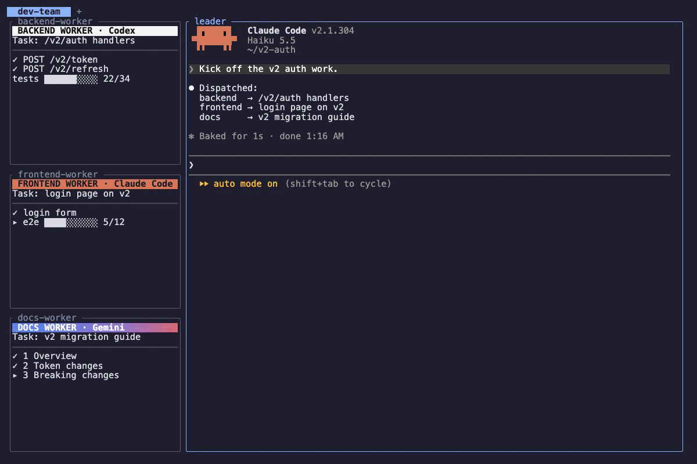
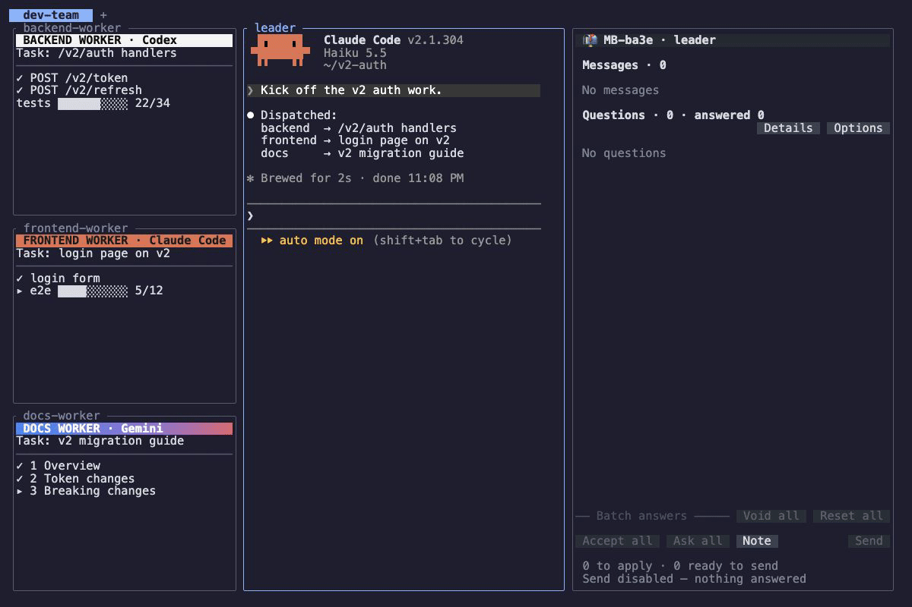

# herdr-mailbox


[English](../README.md) | [简体中文](./zh-sc.md) | [繁體中文](./zh-tc.md) | [Español](./es.md) | [Português](./pt.md) | [Русский](./ru.md) | [日本語](./jp.md) | [Français](./fr.md) | [Deutsch](./de.md) | [Tiếng Việt](./vi.md) | [한국어](./ko.md) | [ไทย](./th.md) | [Italiano](./it.md)

<p align="center">
  <a href="#установка">установка</a> · <a href="#использование">использование</a> · <a href="#отправка-письма">отправка письма</a> · <a href="#ограничения">ограничения</a> · <a href="./guide.md">полное руководство</a>
</p>

> В multi-agent workflow важнее всего твоё внимание и твои решения.

Ты запускаешь в Herdr multi-agent workflow: один агент-leader и несколько агентов-worker, у каждого своя задача. Их отчёты и сообщения заваливают диалог leader. Ты на полуслове, а отчёт уже влез и ушёл вместе с твоим текстом; вопрос на решение, который только что тебе задали, через секунду смывает следующим сообщением.

Этот плагин существует ровно для того, чтобы это исправить: твоё внимание не прерывается и остаётся для действительно важных решений, которые можешь принять только ты.

Это не очередная копия вопросов с вариантами из Claude Code (AskUserQuestion). Плагин использует возможности Herdr, чтобы собрать отчёты и открытые вопросы агентов от разных разработчиков в одном месте, объединить их и согласовать; а раз диалог больше не заваливает сообщениями, он ещё и экономит расход, который ушёл бы на этот поток.

**До**



Mailbox даёт leader почтовый ящик. Worker бросают туда обычные сообщения, как открытки; карточки решений и карточки обсуждений, на которые отвечаешь ты, кладёт сам leader, и каждая карточка указывает, откуда взялся её вопрос. Обычные сообщения доставляются одной пачкой, только когда ты не печатаешь и leader свободен; карточки лежат в ящике, пока ты не ответишь на них мышью.

**После**



- **Поле ввода остаётся твоим** — пока ты печатаешь, туда ничего не попадёт, а пока leader отвечает, ничего не придёт.
- **Обычные сообщения приходят вместе** — обычные сообщения ждут до минуты, чтобы уйти одной пачкой и разбудить leader только раз; **Отправить** пропускает ожидание.
- **Вопросы в одном месте** — вопросы на решение становятся карточками рядом с leader, и на каждой указан источник вопроса; отвечай мышью, и все ответы уйдут одной пачкой.
- **Писать может любой агент** — отправителю нужно лишь выполнить `mailbox send`, поэтому Claude Code, Codex, agy и любой агент, способный запустить команду shell, пишут в один и тот же ящик.
- **Квитанция на каждую отправку** — каждая отправка сразу возвращает id и статус письма.
- **Ящик идёт за leader** — перенос панели, перезапуск Herdr или очистка диалога не отвязывают ящик от того же получателя.

## Установка

Нужны Herdr 0.9.3 или новее и Node 18 или новее.

```sh
# 1. Установить плагин
herdr plugin install navishachiku/herdr-mailbox

# 2. Запустить его действие setup: команда `mailbox`, hooks для Claude Code, разрешающие правила для Codex и agy и защита отправки для Codex и agy
herdr plugin action invoke setup --plugin herdr-mailbox

# 3. Собственные интеграции Herdr с агентами, для каждого агента, которым ты пользуешься
herdr integration install claude
herdr integration install codex
herdr integration install antigravity-cli

# 4. Skill, который учит агентов отправлять письма
npx skills add navishachiku/herdr-mailbox --global
```

Для неинтерактивной установки плагина добавь `--yes` к шагу 1: `herdr plugin install navishachiku/herdr-mailbox --yes`.

Интеграции Herdr определяют диалог в каждой панели, чтобы ящик мог привязаться к своему получателю. Если автоматический режим агента отказывается выполнять шаг 3, выполни нужные команды сам в терминале. Без интеграции отправка может работать, но ящик, возможно, не сможет привязаться к диалогу получателя.

Агент без системы skill может прочитать те же инструкции из `mailbox skill`; вставь его вывод в файл инструкций агента.

Действие setup делает резервную копию каждого файла перед изменением (`<file>.bak-<date>`), при повторном запуске ничего не добавляет дважды и продолжает работать после `herdr plugin update`. `node <plugin dir>/src/setup.mjs uninstall` откатывает его. Перезапусти сессии Claude Code, которые должны получать почту. Codex один раз спросит на своём экране, доверять ли новому hook.

После `herdr plugin update` запусти действие setup ещё раз: хуки Claude Code переписывает только setup, и выпуск, добавляющий источник события (например, `fork`, благодаря которому ящик продолжает подтверждать доставку, когда получатель переносит разговор в фон), доходит до уже настроенной машины только так.

Добавь сочетание клавиш в `config.toml` Herdr (`~/.config/herdr/config.toml`; в Windows `%APPDATA%\herdr\config.toml`), затем перезагрузи через `prefix+shift+r` (`prefix` по умолчанию — `ctrl+b`):

```toml
[[keys.command]]
key = "prefix+shift+m"
type = "plugin_action"
command = "herdr-mailbox.open"
description = "open the mailbox"

[ui.toast]
delivery = "herdr"
```

Если действие на твоей машине не работает, в [AGENT-SETUP.md](../AGENT-SETUP.md) есть те же шаги, которые может выполнить coding agent.

## Использование

Открывай почтовый ящик в окне leader: выбери панель leader и нажми `prefix+shift+m`. Ящик принадлежит агенту, на панели которого ты нажал сочетание, поэтому нажимай его на панели leader, а не worker. Экран почтового ящика откроется рядом с leader; повторное нажатие сочетания на самом экране или `q` закрывает его, а письма остаются.

- **Сообщения** — обычные сообщения от worker ждут здесь и уходят к leader одной пачкой; **Отправить** отправляет их сразу.
- **Вопросы** — карточки решений и обсуждений. Выбери вариант или напиши заметку, затем **Отправить** вернёт все ответы одной пачкой. **Принять все**, **Уточнить все** и **Отменить все** действуют сразу на много карточек.
- **Опции** — ширина экрана, режим карточек, сколько обычные сообщения ждут объединения, и язык экрана (13 языков).

Если экран не открыт, новый вопрос на решение или для обсуждения вызывает уведомление Herdr с текстом вопроса; пока экран открыт, уведомления нет. Worker пишут leader через `mailbox send`, см. ниже.

**Захват ящика**: когда диалог leader заменяется, ящик отключается, а письма в нём остаются. Выполни строку `mailbox claim MB-xxxx`, показанную на экране, в панели нового агента, и ящик снова подключится. Если передаёшь ящик преемнику намеренно, сначала выполни `mailbox release` в панели текущего получателя: ящик сразу отключится, и преемнику не придётся ждать, пока эту панель сочтут исчезнувшей (около 20 секунд). С `--next <панель или имя агента>` ты указываешь панель преемника: заметки для этой панели ждут в этом ящике, пока его не захватят, а не вводятся в панель, где агент ещё запускается.

**Обновление ящика**: чтобы начать с чистого листа с новым идентификатором, а не тащить длинную историю, выполни `mailbox renew` в pane получателя или нажми **Обновить** вверху экрана. Pane получает новый идентификатор ящика, и экран переключается на него. Ещё не отправленные сообщения и вопросы переезжают вместе с черновиками; история пакетов остаётся за старым идентификатором. Письма на старый идентификатор навсегда пересылаются в самый новый ящик, а в квитанции отправителя сказано, что идентификатор изменился.

**Пока тебя нет**: получатель запускает в своём pane `mailbox away on`; карточки по-прежнему приходят, но уведомлений не вызывают. `mailbox away off` вызывает одно уведомление о карточках, пришедших за это время и всё ещё ожидающих.

## Отправка письма

```sh
mailbox send --to <address|MB-id> --type note "tests pass"

mailbox send --to <address|MB-id> --type decision \
  --question "Install the skill too?" --option "Yes" --option "No" \
  --tradeoff "Agents can send letters; one more skill to keep updated" \
  --tradeoff "Nothing new to maintain; agents must be told by hand" \
  --why-open "No rule says whether agents get the skill" --recommend A \
  --source-uid <uid>
```

В `--to` можно указать id панели, имя агента или id ящика. `--recommend` необязателен; карточка без него не показывает рекомендуемый вариант.

У каждой карточки есть источник: `--source-uid <uid>` принимает uid письма из этого ящика, из-за которого возник вопрос, и карточка показывает отправителя этого письма так, как он подписался; если такого письма нет, `--source "<кто или что поднял вопрос>"` принимает несколько слов.

Более длинный материал прикладывается к письму файлом (`--attach <file>`, до 5 на письмо); на карточке появляется ссылка, и по клику файл открывается в программе системы по умолчанию (изображение — в просмотрщике изображений, текстовый файл — в приложении по умолчанию). Веб-адреса в вопросе открываются в браузере по умолчанию.

С `--wait [--timeout <ms>]` отправка возвращается только после того, как leader принял письмо и завершил свой ход. Если ожидание прекращается, команда завершается с кодом 3 или 4; письмо в ящик в любом случае уже в очереди или доставлено, так что не отправляй его повторно. Письмо в панель без ящика подписывается и сразу один раз впечатывается прямо в неё. Вопросы для обсуждения, проверка, правка и отзыв писем и все кнопки экрана описаны в [полном руководстве](./guide.md).

## Ограничения

- Вопрос — не более 200 символов, обычное сообщение — не более 500; более длинный текст кладётся в файл через `--attach`.
- Агент, которому принадлежит ящик (leader), должен быть Claude Code или agy, потому что доставка ждёт, пока его поле ввода опустеет, а прочитать можно только поля ввода этих двух; отправителем может быть любой агент.

## Правила карточек (необязательно)

Чтобы отклонять письма с нежелательной фразой или слишком длинным предложением, создайте `card-rules.json` в каталоге состояния плагинов Herdr, рядом с `prefs.json` (точный путь покажет `mailbox --help`):

```json
{"rejectPhrases": ["as you know", "basically"], "maxSentenceUnits": 50}
```

- `rejectPhrases`: письмо, в тексте которого есть любая из этих фраз (без учёта регистра), отклоняется, и отправителю сообщается, какая именно.
- `maxSentenceUnits`: письмо с более длинным предложением отклоняется. Китайский иероглиф считается за 1, как и непрерывная последовательность букв или цифр; предложения заканчиваются на `。！？.!?` или переводе строки.

Оба ключа необязательны, неверное значение игнорируется. Без файла принимаются все письма. Проверяется текст заметки, вопроса, вариантов, компромиссов, why-open и idea; вложения не читаются.

## Известные проблемы

- **Codex: пока не может владеть ящиком.** Codex 0.163 запускает свои диалоги на одном общем фоновом сервере, поэтому интеграция Herdr с Codex сообщает о каждом диалоге той панели, которая запустила этот сервер, а сама панель Codex так и не получает id диалога, к которому можно привязать ящик. Codex по-прежнему может отправлять письма, а обычное сообщение в панель Codex без ящика подписывается и один раз впечатывается прямо в неё. id панели Codex в `HERDR_PANE_ID` может быть неверным, поэтому отправитель на Codex должен указывать свою панель через `--from <pane id>`.
- **agy: skill устанавливается не туда, откуда его читает agy.** CLI `skills` не умеет устанавливать в папку, из которой agy загружает skills, поэтому `npx skills add` до неё не доходит. Это ограничение самого CLI; почтовый ящик его не обходит.
- **agy: его песочница блокирует отправку.** `herdr agent prompt` от agy владельцу ящика переписывается в заметку в ящике, но пока песочница agy включена, agy не может запустить ни `herdr`, ни `mailbox send` (сокет демона ящика тоже заблокирован), поэтому он ничего не отправляет — есть у адресата ящик или нет.

<details>
<summary>Для продвинутых: как это работает, состояние, тесты</summary>

### Как это работает

Небольшой демон владеет файлом состояния и обрабатывает по одному запросу за раз. CLI общается с ним через локальный сокет и запускает его, если он не работает. Состояние хранится в каталоге состояния плагинов Herdr, вне каталога с кодом плагина, с номером версии схемы, и записывается на диск до того, как вернётся квитанция. У каждой сессии Herdr свой подкаталог, свой демон и свои ящики, поэтому один и тот же адрес панели в двух сессиях никогда не делит письма.

| Часть | Роль |
| --- | --- |
| `src/daemon.mjs`, `src/core.mjs` | Демон и правила для писем: квитанции, дедупликация, правка и отзыв, лимиты. |
| `src/identity.mjs` | Привязка ящика к получателю, цикл сверки, захват ящика. |
| `src/delivery.mjs`, `src/format.mjs`, `src/input-box.mjs` | Пакетная доставка, проверка поля ввода, подтверждение, текст пачки. |
| `src/screen/` | Экран почтового ящика, настройки показываются прямо в нём; вложения и ссылки передаются программам системы по умолчанию. |
| `src/open.mjs`, `src/on-focus.mjs` | Действие `prefix+shift+m` и повторное открытие экрана после перезапуска Herdr. |
| `src/session-start.mjs`, `src/prompt-submit.mjs`, `src/send-guard.mjs` | Хуки Claude Code. |

### Тесты

```sh
npm test
```

Запускает настоящие CLI и демон против поддельного бинарника `herdr` в одноразовом каталоге состояния.

</details>

## Лицензия

MIT
