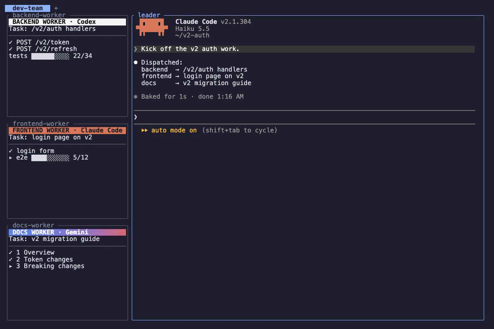
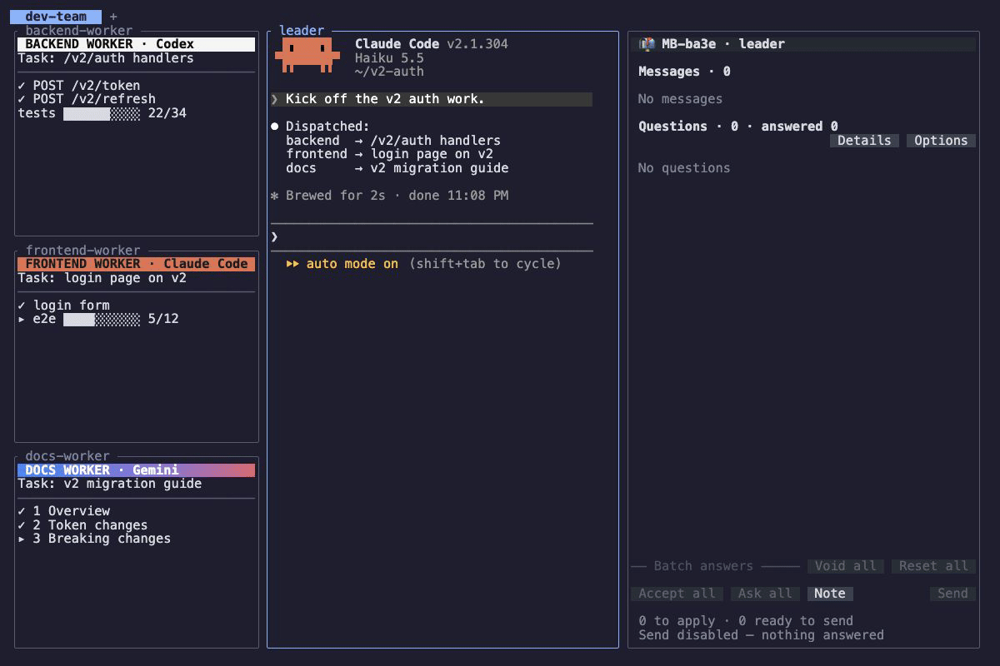

# herdr-mailbox


[English](../README.md) | [简体中文](./zh-sc.md) | [繁體中文](./zh-tc.md) | [Español](./es.md) | [Português](./pt.md) | [Русский](./ru.md) | [日本語](./jp.md) | [Français](./fr.md) | [Deutsch](./de.md) | [Tiếng Việt](./vi.md) | [한국어](./ko.md) | [ไทย](./th.md) | [Italiano](./it.md)

<p align="center">
  <a href="#ติดตั้ง">ติดตั้ง</a> · <a href="#การใช้งาน">การใช้งาน</a> · <a href="#ส่งจดหมาย">ส่งจดหมาย</a> · <a href="#ข้อจำกัด">ข้อจำกัด</a> · <a href="./guide.md">คู่มือฉบับเต็ม</a>
</p>

> ใน multi-agent workflow สิ่งที่สำคัญที่สุดคือสมาธิและการตัดสินใจของคุณ

คุณรัน multi-agent workflow ใน Herdr โดยมี leader agent หนึ่งตัวกับ worker agent อีกหลายตัว แยกกันทำคนละงาน รายงานและข้อความของพวกมันหลั่งไหลเข้ามาท่วมบทสนทนาของ leader คุณพิมพ์ไปได้แค่ครึ่งประโยค รายงานก็แทรกเข้ามาแล้วถูกส่งออกไปพร้อมกัน ส่วนคำถามที่เพิ่งรอให้คุณตัดสินใจก็ถูกข้อความถัดไปไหลท่วมหายไปในวินาทีต่อมา

ปลั๊กอินนี้มีขึ้นเพื่อแก้ปัญหานี้โดยตรง ให้สมาธิของคุณไม่ถูกขัดจังหวะ และเก็บไว้ใช้กับการตัดสินใจคุณภาพสูงที่มีแต่คุณเท่านั้นที่ทำได้

มันไม่ใช่การสร้างคำถามแบบตัวเลือกของ Claude Code (AskUserQuestion) ขึ้นมาใหม่ แต่ใช้ความสามารถของ Herdr รวบรวมรายงานและคำถามที่รอการตัดสินใจจาก agent ต่างค่ายมาไว้ที่เดียว แล้วรวมและประสานให้เป็นระเบียบ และเมื่อบทสนทนาไม่ถูกข้อความท่วมอีกต่อไป ก็ช่วยประหยัดปริมาณการใช้งานที่ต้องเสียไปกับสิ่งเหล่านั้นด้วย

**ก่อนใช้**



Mailbox มอบกล่องจดหมายให้ leader worker ส่งข้อความทั่วไป (เหมือนโปสการ์ด) ส่วนการ์ดตัดสินใจและการ์ดสนทนาที่ให้คุณตอบนั้น leader เป็นคนส่งเอง และการ์ดทุกใบบอกที่มาของคำถาม ข้อความทั่วไปจะถูกส่งเข้าไปเป็นชุดเดียวก็ต่อเมื่อคุณไม่ได้พิมพ์อยู่และ leader ว่าง ส่วนการ์ดจะรออยู่ในกล่องจดหมายจนกว่าคุณจะใช้เมาส์ตอบ

**หลังใช้**



- **ช่องพิมพ์เป็นของคุณเสมอ** — ไม่มีอะไรถูกพิมพ์แทรกขณะที่คุณกำลังพิมพ์ และไม่มีอะไรถูกส่งเข้าไปขณะที่ leader ยังตอบอยู่
- **ข้อความทั่วไปมาพร้อมกัน** — ข้อความทั่วไปรอได้สูงสุดหนึ่งนาทีเพื่อรวมเป็นชุดเดียวและปลุก leader แค่ครั้งเดียว ถ้าไม่อยากรอให้กด **ส่งเลย**
- **คำถามอยู่ที่เดียว** — คำถามตัดสินใจกลายเป็นการ์ดข้าง leader โดยการ์ดแต่ละใบบอกที่มาของคำถาม ตอบด้วยเมาส์แล้วส่งคำตอบทั้งหมดกลับทีเดียว
- **agent ตัวไหนก็ส่งได้** — ฝั่งผู้ส่งแค่รัน `mailbox send` ดังนั้น Claude Code, Codex, agy และ agent ใดก็ตามที่รันคำสั่ง shell ได้ ก็เขียนลงกล่องจดหมายเดียวกันได้
- **ส่งทุกครั้งมีใบรับ** — ทุกครั้งที่ส่งจะได้รับ id และสถานะของจดหมายกลับมาทันที
- **ตาม leader ไปด้วย** — ย้าย pane, รีสตาร์ท Herdr หรือล้างบทสนทนา กล่องจดหมายก็ยังเป็นของผู้รับคนเดิม

## ติดตั้ง

ต้องใช้ Herdr 0.9.3 ขึ้นไป และ Node 18 ขึ้นไป

```sh
# 1. ติดตั้งปลั๊กอิน
herdr plugin install navishachiku/herdr-mailbox

# 2. รันการกระทำ setup: คำสั่ง `mailbox`, hooks ของ Claude Code, กฎอนุญาตของ Codex กับ agy และตัวป้องกันการส่งของ Codex กับ agy
herdr plugin action invoke setup --plugin herdr-mailbox

# 3. การเชื่อมต่อ agent ของ Herdr เอง ติดตั้งตาม agent ที่คุณใช้
herdr integration install claude
herdr integration install codex
herdr integration install antigravity-cli

# 4. skill ที่สอน agent ให้ส่งจดหมาย
npx skills add navishachiku/herdr-mailbox --global
```

สำหรับการติดตั้งปลั๊กอินแบบไม่โต้ตอบ ให้เพิ่ม `--yes` ในขั้นตอนที่ 1: `herdr plugin install navishachiku/herdr-mailbox --yes`

การเชื่อมต่อของ Herdr ใช้ระบุบทสนทนาในแต่ละ pane เพื่อให้กล่องจดหมายผูกกับผู้รับได้ ถ้าโหมดอัตโนมัติของ agent ปฏิเสธขั้นตอนที่ 3 ให้รันคำสั่งที่เกี่ยวข้องเองใน terminal ถ้าไม่มีการเชื่อมต่อนี้ การส่งอาจยังใช้ได้ แต่กล่องจดหมายอาจผูกกับบทสนทนาของผู้รับไม่ได้

agent ที่ไม่มีระบบ skill อ่านคำแนะนำชุดเดียวกันได้จาก `mailbox skill` ให้วางผลลัพธ์ของคำสั่งนี้ลงในไฟล์คำสั่งของ agent นั้น

การกระทำ setup จะสำรองทุกไฟล์ก่อนแก้ไข (`<file>.bak-<date>`) รันซ้ำก็ไม่เพิ่มอะไรซ้ำ และยังทำงานได้ตามปกติหลัง `herdr plugin update` ย้อนกลับได้ด้วย `node <plugin dir>/src/setup.mjs uninstall` จากนั้นรีสตาร์ท session ของ Claude Code ที่จะรับจดหมาย Codex จะถามหนึ่งครั้งบนหน้าจอของมัน ว่าไว้ใจ hook ใหม่หรือไม่

หลัง `herdr plugin update` ให้รันการกระทำ setup อีกครั้งหนึ่ง: hook ของ Claude Code ถูกเขียนใหม่โดย setup เท่านั้น และรุ่นที่เพิ่มแหล่งเหตุการณ์ (เช่น `fork` ที่ทำให้กล่องจดหมายยืนยันต่อได้เมื่อผู้รับย้ายบทสนทนาไปทำงานเบื้องหลัง) จะถึงเครื่องที่ติดตั้งไว้แล้วด้วยวิธีนี้เท่านั้น

เพิ่มปุ่มลัดลงใน `config.toml` ของ Herdr (`~/.config/herdr/config.toml` บน Windows คือ `%APPDATA%\herdr\config.toml`) แล้วโหลดใหม่ด้วย `prefix+shift+r` (`prefix` คือ `ctrl+b` ถ้าคุณไม่ได้เปลี่ยน):

```toml
[[keys.command]]
key = "prefix+shift+m"
type = "plugin_action"
command = "herdr-mailbox.open"
description = "open the mailbox"

[ui.toast]
delivery = "herdr"
```

ถ้าการกระทำ setup ใช้ไม่ได้บนเครื่องของคุณ [AGENT-SETUP.md](../AGENT-SETUP.md) มีขั้นตอนเดียวกันให้ coding agent ทำตาม

## การใช้งาน

เปิดกล่องจดหมายในหน้าต่างของ leader: โฟกัสที่ pane ของ leader แล้วกด `prefix+shift+m` กล่องจดหมายเป็นของ agent ใน pane ที่คุณกดปุ่มลัด ดังนั้นต้องกดที่ pane ของ leader ไม่ใช่ของ worker หน้าจอกล่องจดหมายจะเปิดข้าง leader กดปุ่มลัดอีกครั้งจากในหน้าจอ หรือกด `q` เพื่อปิด จดหมายยังอยู่ครบ

- **ข้อความทั่วไป** — ข้อความทั่วไปจาก worker รออยู่ที่นี่ แล้วถูกส่งเข้า leader เป็นชุดเดียว กด **ส่งเลย** เพื่อส่งทันที
- **คำถาม** — การ์ดตัดสินใจและการ์ดสนทนา คลิกตัวเลือกหรือเขียนบันทึก แล้วกด **ส่ง** เพื่อส่งคำตอบทั้งหมดกลับทีเดียว **ตามแนะนำทั้งหมด**, **ขออธิบายทั้งหมด** และ **ยกเลิกทั้งหมด** จัดการการ์ดหลายใบพร้อมกันได้
- **ตั้งค่า** — ความกว้างของหน้าจอ โหมดการ์ด เวลาที่ข้อความทั่วไปรอเพื่อรวมชุด และภาษาของหน้าจอ (13 ภาษา)

เมื่อไม่ได้เปิดหน้าจอไว้ คำถามตัดสินใจหรือคำถามสนทนาใหม่จะทำให้ Herdr แจ้งเตือนพร้อมตัวคำถาม แต่ถ้าเปิดหน้าจออยู่จะไม่มีการแจ้งเตือน worker เขียนถึง leader ด้วย `mailbox send` ตามด้านล่าง

**การเคลมกล่องจดหมาย**: เมื่อบทสนทนาของ leader ถูกแทนที่ กล่องจดหมายจะหลุดการเชื่อมต่อ แต่จดหมายยังอยู่ รันบรรทัด `mailbox claim MB-xxxx` ที่แสดงบนหน้าจอใน pane ของ agent ตัวใหม่ แล้วกล่องจดหมายจะเชื่อมต่อกลับมา ถ้าตั้งใจส่งต่อกล่องจดหมายให้ผู้รับช่วง ให้รัน `mailbox release` ใน pane ของผู้รับปัจจุบันก่อน กล่องจดหมายจะหลุดการเชื่อมต่อทันที ผู้รับช่วงจึงไม่ต้องรอจนกว่า pane นี้จะถูกตัดสินว่าหายไป (ราว 20 วินาที) เพิ่ม `--next <pane หรือชื่อ agent>` เพื่อระบุ pane ของผู้รับช่วง โน้ตที่ส่งถึง pane นั้นจะรออยู่ในกล่องจดหมายนี้จนกว่าจะถูกเคลม แทนที่จะถูกพิมพ์เข้า pane ที่ agent ยังเริ่มทำงานอยู่

**การทำกล่องจดหมายใหม่**: ถ้าอยากเริ่มใหม่ด้วยรหัสใหม่แทนที่จะแบกประวัติยาว ๆ ให้รัน `mailbox renew` ใน pane ของผู้รับ หรือกด **ทำใหม่** ที่ด้านบนของหน้าจอ pane จะได้รหัสกล่องจดหมายใหม่ และหน้าจอจะสลับไปแสดงกล่องนั้น ข้อความและคำถามที่ยังไม่ได้ส่งจะย้ายตามไปพร้อมร่างคำตอบ ส่วนประวัติของแต่ละชุดจะอยู่กับรหัสเดิม จดหมายที่ส่งถึงรหัสเก่าจะถูกส่งต่อไปยังกล่องล่าสุดตลอดไป และใบตอบรับของผู้ส่งจะบอกว่ารหัสเปลี่ยนแล้ว

**ขณะที่คุณไม่อยู่**: ผู้รับรัน `mailbox away on` ใน pane ของตัวเอง การ์ดยังเข้ามาตามปกติแต่จะไม่มีการแจ้งเตือน เมื่อรัน `mailbox away off` จะมีการแจ้งเตือนหนึ่งครั้งสำหรับการ์ดที่เข้ามาระหว่างนั้นและยังรออยู่

## ส่งจดหมาย

```sh
mailbox send --to <address|MB-id> --type note "tests pass"

mailbox send --to <address|MB-id> --type decision \
  --question "Install the skill too?" --option "Yes" --option "No" \
  --tradeoff "Agents can send letters; one more skill to keep updated" \
  --tradeoff "Nothing new to maintain; agents must be told by hand" \
  --why-open "No rule says whether agents get the skill" --recommend A \
  --source-uid <uid>
```

`--to` รับได้ทั้ง pane id, ชื่อ agent หรือ id ของกล่องจดหมาย `--recommend` ใส่หรือไม่ใส่ก็ได้ การ์ดที่ไม่มีจะไม่แสดงตัวเลือกที่แนะนำ

การ์ดทุกใบต้องมีที่มา: `--source-uid <uid>` รับ uid ของจดหมายในกล่องนั้นที่ทำให้เกิดคำถาม และการ์ดจะแสดงผู้ส่งจดหมายฉบับนั้นตามที่เขาลงนามไว้ ถ้าไม่มีจดหมายฉบับใด ให้ใช้ `--source "<ใครหรืออะไรเป็นผู้ยกคำถามนี้>"` เขียนเป็นคำสั้น ๆ

เนื้อหายาว ๆ แนบไปกับจดหมายเป็นไฟล์ได้ (`--attach <file>` สูงสุด 5 ไฟล์ต่อฉบับ) บนการ์ดจะมีลิงก์ คลิกแล้วไฟล์จะเปิดด้วยโปรแกรมเริ่มต้นของระบบ (รูปภาพเปิดในโปรแกรมดูรูป ไฟล์ข้อความเปิดในแอปเริ่มต้น) ที่อยู่เว็บในคำถามจะเปิดในเบราว์เซอร์เริ่มต้น

`--wait [--timeout <ms>]` ทำให้คำสั่งส่งกลับมาก็ต่อเมื่อ leader รับจดหมายแล้วและจบเทิร์นนั้นแล้ว ถ้าเลิกรอจะจบด้วยรหัส 3 หรือ 4 จดหมายที่ส่งถึงกล่องจดหมายไม่ว่ากรณีไหนก็เข้าคิวแล้วหรือส่งถึงแล้ว จึงไม่ต้องส่งซ้ำ จดหมายที่ส่งถึง pane ที่ไม่มีกล่องจดหมายจะถูกลงชื่อแล้วพิมพ์เข้าไปตรง ๆ ทันทีหนึ่งครั้ง ส่วนคำถามสนทนา การตรวจสอบ แก้ไขและเรียกคืนจดหมาย และปุ่มทุกปุ่มบนหน้าจอ ดูได้ใน[คู่มือฉบับเต็ม](./guide.md)

## ข้อจำกัด

- คำถามยาวได้สูงสุด 200 ตัวอักษร ข้อความทั่วไปสูงสุด 500 ตัวอักษร ถ้ายาวกว่านั้นให้ใส่ในไฟล์แล้วแนบด้วย `--attach`
- agent ที่เป็นเจ้าของกล่องจดหมาย (leader) ต้องเป็น Claude Code หรือ agy เพราะการส่งมอบต้องรอให้ช่องพิมพ์ของมันว่างก่อน และมีเพียงช่องพิมพ์ของสองตัวนี้ที่อ่านได้ ส่วนฝั่งผู้ส่งเป็น agent ตัวไหนก็ได้

## กฎของการ์ด (ไม่บังคับ)

หากต้องการปฏิเสธจดหมายที่มีวลีที่ไม่ต้องการหรือประโยคที่ยาวเกินไป ให้สร้าง `card-rules.json` ในไดเรกทอรีสถานะปลั๊กอินของ Herdr ข้าง `prefs.json` (`mailbox --help` จะแสดงพาธที่แน่นอน):

```json
{"rejectPhrases": ["as you know", "basically"], "maxSentenceUnits": 50, "stepPatterns": ["^(open|press|log in) "]}
```

- `rejectPhrases`: จดหมายที่ข้อความมีวลีใดวลีหนึ่งเหล่านี้ (ไม่แยกตัวพิมพ์เล็กใหญ่) จะถูกปฏิเสธ และผู้ส่งจะได้รับแจ้งว่าเป็นวลีใด
- `maxSentenceUnits`: จดหมายที่มีประโยคยาวกว่านี้จะถูกปฏิเสธ อักษรจีน 1 ตัวนับเป็น 1 และตัวอักษรหรือตัวเลขที่ต่อเนื่องกัน 1 ชุดก็นับเป็น 1 ประโยคจบที่ `。！？.!?` หรือการขึ้นบรรทัดใหม่
- `stepPatterns`: นิพจน์ปกติ (ไม่แยกตัวพิมพ์ใหญ่เล็ก) การ์ดตัดสินใจหรือการ์ดอภิปรายจะถูกปฏิเสธเมื่อบรรทัดที่เป็นหัวข้อย่อยหรือมีเลขลำดับในข้อความอิสระ (เมื่อตัดเครื่องหมายหน้าบรรทัดออก) ตรงกับรูปแบบใดรูปแบบหนึ่ง และผู้ส่งจะถูกแจ้งให้ใส่ทุกขั้นตอนที่คุณต้องทำเองไว้ใน `--step` พร้อม `--why-not-agent` บอกเหตุผลที่ agent ทำเองไม่ได้ หากไม่มีคีย์นี้ จะใช้รายการกริยาการกระทำที่พบบ่อยที่มีมาในตัว (เช่น open, press, click, run, type และคำภาษาจีนที่ตรงกัน) และ `[]` จะปิดการตรวจ

ทุกคีย์ไม่บังคับ และค่าที่ไม่ถูกต้องจะถูกละเลย หากไม่มีไฟล์ จะไม่มีกฎเรื่องวลีหรือความยาว และการตรวจขั้นตอนใช้รายการที่มีมาในตัว ข้อความที่ตรวจคือโน้ต คำถาม ตัวเลือก ข้อแลกเปลี่ยน why-open, idea, ขั้นตอน และเหตุผลของแต่ละขั้น ไฟล์แนบไม่ถูกอ่าน

## ปัญหาที่ทราบ

- **Codex: ยังเป็นเจ้าของกล่องจดหมายไม่ได้** Codex 0.163 รันทุกบทสนทนาในเซิร์ฟเวอร์เบื้องหลังตัวเดียวที่ใช้ร่วมกัน การเชื่อมต่อ Codex ของ Herdr จึงรายงานทุกบทสนทนาไปที่ pane ที่สตาร์ทเซิร์ฟเวอร์นั้น และ pane ของ Codex เองไม่ได้รับ id ของบทสนทนาที่จะผูกกล่องจดหมายได้ Codex ยังส่งจดหมายได้ และข้อความทั่วไปที่ส่งถึง pane ของ Codex ที่ไม่มีกล่องจดหมายจะถูกลงชื่อแล้วพิมพ์เข้าไปตรง ๆ หนึ่งครั้ง `HERDR_PANE_ID` ของ Codex อาจชี้ไปผิด pane ดังนั้นผู้ส่งที่เป็น Codex ต้องระบุ pane ของตัวเองด้วย `--from <pane id>`
- **agy: skill ไม่ได้ติดตั้งไว้ในที่ที่ agy อ่าน** `skills` CLI ติดตั้งลงในโฟลเดอร์ที่ agy โหลด skill ไม่ได้ ดังนั้น `npx skills add` จึงไปไม่ถึง agy นี่เป็นข้อจำกัดของ CLI ตัวนั้น กล่องจดหมายไม่ได้หาทางเลี่ยงให้
- **agy: sandbox ของมันบล็อกการส่ง** `herdr agent prompt` จาก agy ถึงเจ้าของกล่องจดหมายจะถูกเขียนใหม่เป็นข้อความทั่วไปในกล่องจดหมาย แต่ตอนที่ sandbox ของ agy เปิดอยู่ agy รันทั้ง `herdr` และ `mailbox send` ไม่ได้ (socket ของ daemon กล่องจดหมายก็ถูกบล็อกด้วย) จึงส่งอะไรไม่ได้เลย ไม่ว่าปลายทางจะมีกล่องจดหมายหรือไม่

<details>
<summary>ขั้นสูง: หลักการทำงาน สถานะ การทดสอบ</summary>

### หลักการทำงาน

daemon ตัวเล็กหนึ่งตัวดูแลไฟล์สถานะและประมวลผลทีละคำขอ CLI คุยกับมันผ่าน socket ในเครื่อง และจะสตาร์ทมันให้เมื่อยังไม่ได้รันอยู่ สถานะเก็บไว้ในไดเรกทอรีสถานะของปลั๊กอิน Herdr (ไม่ได้อยู่ในไดเรกทอรีโค้ดของปลั๊กอิน) มีเวอร์ชันของ schema กำกับ และถูกเขียนลงดิสก์ก่อนที่จะส่งใบรับกลับ แต่ละ session ของ Herdr มีไดเรกทอรีย่อย daemon และกล่องจดหมายเป็นของตัวเอง ดังนั้นที่อยู่ pane เดียวกันใน session สองตัวจะไม่ใช้จดหมายร่วมกัน

| ส่วนประกอบ | หน้าที่ |
| --- | --- |
| `src/daemon.mjs`, `src/core.mjs` | daemon และกฎของจดหมาย: ใบรับ การตัดรายการซ้ำ การแก้ไขและเรียกคืน ขีดจำกัดความยาว |
| `src/identity.mjs` | ผูกกล่องจดหมายเข้ากับผู้รับ วงจรตรวจสอบให้ตรงกัน การเคลมกล่องจดหมาย |
| `src/delivery.mjs`, `src/format.mjs`, `src/input-box.mjs` | การส่งมอบเป็นชุด การตรวจช่องพิมพ์ การยืนยันว่าส่งถึง ข้อความของแต่ละชุด |
| `src/screen/` | หน้าจอกล่องจดหมาย การตั้งค่าแสดงอยู่ในหน้าจอนี้ ส่วนไฟล์แนบและลิงก์จะส่งให้โปรแกรมเริ่มต้นของระบบ |
| `src/open.mjs`, `src/on-focus.mjs` | การกระทำของ `prefix+shift+m` และการเปิดหน้าจอกล่องจดหมายใหม่หลัง Herdr รีสตาร์ท |
| `src/session-start.mjs`, `src/prompt-submit.mjs`, `src/send-guard.mjs` | hooks ของ Claude Code |

### การทดสอบ

```sh
npm test
```

รัน CLI และ daemon ตัวจริงกับไฟล์ปฏิบัติการ `herdr` ปลอม ในไดเรกทอรีสถานะแบบใช้แล้วทิ้ง

</details>

## สัญญาอนุญาต

MIT
