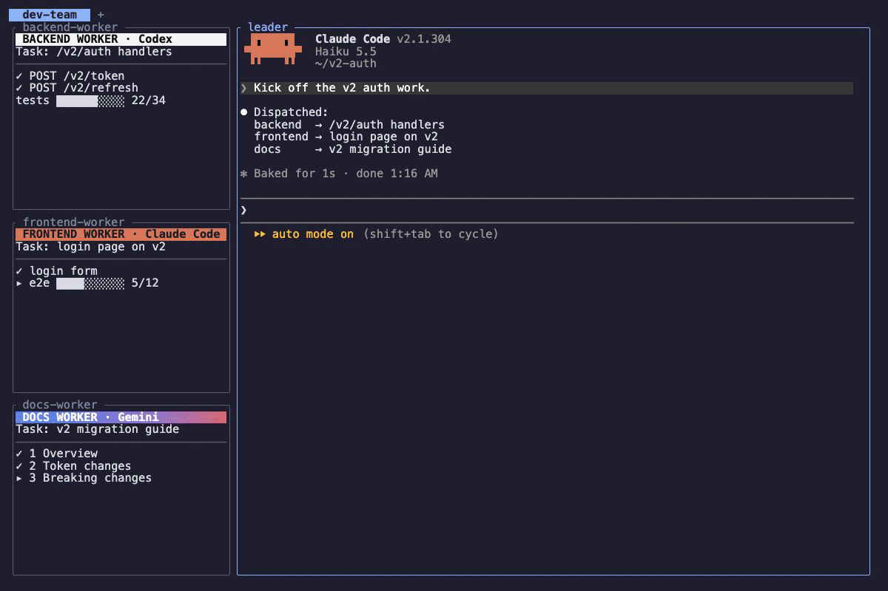
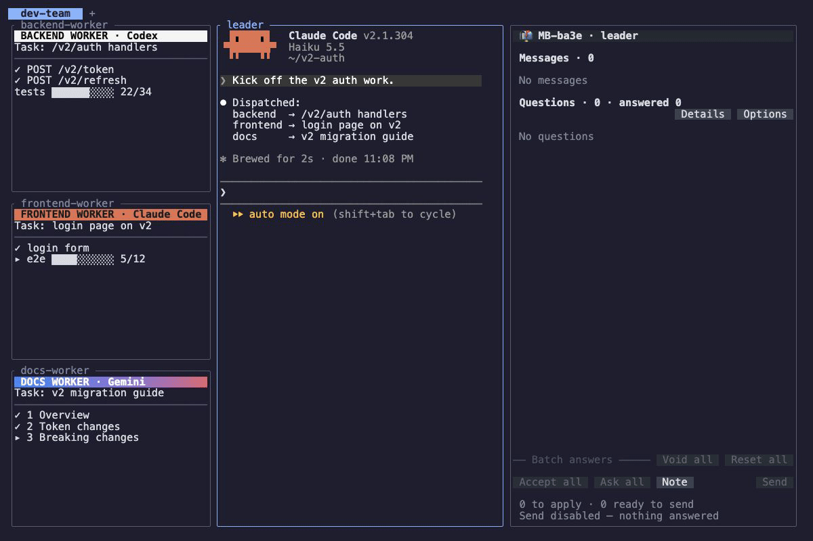

# herdr-mailbox


[English](../README.md) | [简体中文](./zh-sc.md) | [繁體中文](./zh-tc.md) | [Español](./es.md) | [Português](./pt.md) | [Русский](./ru.md) | [日本語](./jp.md) | [Français](./fr.md) | [Deutsch](./de.md) | [Tiếng Việt](./vi.md) | [한국어](./ko.md) | [ไทย](./th.md) | [Italiano](./it.md)

<p align="center">
  <a href="#安裝">安裝</a> · <a href="#使用">使用</a> · <a href="#寄信">寄信</a> · <a href="#限制">限制</a> · <a href="./guide.md">完整說明</a>
</p>

> 在 multi-agent workflow 中，你的注意力與決策是一切的關鍵

你在 Herdr 跑 multi-agent workflow，一個 agent Leader 帶著好幾個 agent Worker 分頭做事。它們的回報與溝通訊息會瘋狂地轟炸 Leader 的對話窗：你一句話才打到一半，回報就插進來跟著送出去；剛剛問你的決策題，下一秒就被新訊息洗到不見。

這個插件就是為了解決這個痛點而存在：讓你的注意力不被打斷，留給真正需要你做的高品質決策。

它不是把 Claude Code 的選項提問（AskUserQuestion）再造一遍，而是借助 Herdr 的特性，把多個不同廠牌 agent 的回報與待決問題集中起來整合、協調；也因為不再連續洗頻，省下額外的用量消耗。

**使用前**



Mailbox 給 Leader 一個信箱。Worker 寄一般訊息（像明信片）；決策卡和討論卡由 Leader 自己投遞給你作答，每張卡都標明問題的來源。一般訊息只在你沒在打字、Leader 也有空的時候才成批送進去；卡片則留在信箱裡，等你用滑鼠作答。

**使用後**



- **輸入框始終是你的** — 你在打字時不會有任何東西被打進去，Leader 還在回話時也不會送進去。
- **一般訊息一起到** — 一般訊息最多等一分鐘，好合成一批送進去、只叫醒 Leader 一次；按 **立即投遞** 可以不等。
- **問題集中一處** — 決策題變成 Leader 旁邊的卡片，每張標明問題的來源；用滑鼠作答，所有答案一次送回。
- **任何 agent 都能寄** — 寄件方只要執行 `mailbox send`，所以 Claude Code、Codex、agy，以及任何能執行 shell 指令的 agent，都能寄到同一個信箱。
- **每封都有回條** — 每次寄出都立即回傳這封信的 id 與狀態。
- **跟著 Leader 走** — 搬動 pane、重啟 Herdr 或清空對話，信箱都還跟著同一個收件者。

## 安裝

需要 Herdr 0.9.3 或更新版本，以及 Node 18 或更新版本。

```sh
# 1. 安裝外掛
herdr plugin install navishachiku/herdr-mailbox

# 2. 執行它的 setup 動作：`mailbox` 指令、Claude Code 的 hooks、Codex 與 agy 的放行規則，以及 Codex 與 agy 的送信攔截
herdr plugin action invoke setup --plugin herdr-mailbox

# 3. Herdr 自己的 agent 整合，有用哪個 agent 就裝哪個
herdr integration install claude
herdr integration install codex
herdr integration install antigravity-cli

# 4. 教 agent 寄信的 skill
npx skills add navishachiku/herdr-mailbox --global
```

非互動安裝外掛時，請在步驟 1 加上 `--yes`：`herdr plugin install navishachiku/herdr-mailbox --yes`。

Herdr 的 agent 整合用來辨識每個 pane 裡的對話，讓信箱能綁定收件者。如果 agent 的自動模式拒絕執行步驟 3，請自行在終端機執行需要的指令。沒有安裝整合時仍可能寄得出信，但信箱可能無法綁定收件者的對話。

沒有 skill 機制的 agent，可以從 `mailbox skill` 讀到同一份說明；把它的輸出貼進該 agent 的指示檔。

setup 動作改任何檔案前都會先備份（`<file>.bak-<date>`），重跑不會重複加，`herdr plugin update` 之後也照常運作。`node <plugin dir>/src/setup.mjs uninstall` 可還原。要收信的 Claude Code session 請重新啟動。Codex 會在它的畫面上問一次，是否信任新的 hook。

`herdr plugin update` 之後請再跑一次 setup 動作：Claude Code 的掛鉤只有 setup 會改寫，新版若增加事件來源（例如 `fork`，讓收件方把對話移到背景後信箱仍能確認），已安裝的機器只能這樣才拿得到。

把快捷鍵加進 Herdr 的 `config.toml`（`~/.config/herdr/config.toml`；Windows 是 `%APPDATA%\herdr\config.toml`），再按 `prefix+shift+r` 重新載入（`prefix` 預設是 `ctrl+b`）：

```toml
[[keys.command]]
key = "prefix+shift+m"
type = "plugin_action"
command = "herdr-mailbox.open"
description = "open the mailbox"

[ui.toast]
delivery = "herdr"
```

如果 setup 動作在你的機器上跑不起來，[AGENT-SETUP.md](../AGENT-SETUP.md) 有同樣的步驟，可以交給 coding agent 照做。

## 使用

信箱要開在 Leader 的視窗：先選到 Leader 的 pane，再按 `prefix+shift+m`。信箱屬於你按下快捷鍵時所在 pane 的 agent，所以要按在 Leader 的 pane 上，不是 Worker 的。信箱畫面會開在 Leader 旁邊；在畫面裡再按一次快捷鍵或按 `q` 就關閉，信件都還在。

- **一般訊息** — Worker 寄來的一般訊息在這裡等著，成批送進 Leader；按 **立即投遞** 馬上送。
- **決策區** — 決策卡與討論卡。點選項或寫備註，再按 **確認送出**，所有答案一次送回。**全部按建議**、**全部再解釋**、**全部作廢** 可以一次處理多張卡。
- **設定** — 畫面寬度、卡片模式、一般訊息等多久合併，以及畫面語言（13 種）。

信箱畫面沒開著時，新的決策題或討論題進來會跳一則帶題目的 Herdr 通知；畫面開著就不跳。Worker 用下面的 `mailbox send` 寄信給 Leader。

**信箱認領**：Leader 的對話換掉後，信箱會斷線，信件都還留著。在新的 agent 的 pane 裡執行畫面上那行 `mailbox claim MB-xxxx`，信箱就接回來了。有意交給接手者時，先在目前接收者的 pane 執行 `mailbox release`：信箱立刻斷線，接手者的認領不必等這個 pane 被判定消失（約 20 秒）。加上 `--next <pane 或 agent 名稱>` 可指定接手者的 pane：寄給該 pane 的筆記會在這個信箱排隊，直到信箱被認領，不會打進 agent 還在啟動的 pane。

**信箱換新**：想用全新的編號重新開始、不揹著一長串歷史時，在收件方的 pane 裡執行 `mailbox renew`，或按畫面上方的 **換新**。pane 會拿到新的信箱編號，畫面也改顯示新信箱。還沒送出的訊息和題目連同草稿一起搬過去，批次紀錄留在舊編號。寄到舊編號的信會永久轉寄到最新的信箱，寄件者的回執會說明編號已更改。

**你不在時**：收件方在自己的 pane 裡執行 `mailbox away on`；卡片照常收下，但不發通知。`mailbox away off` 會為這段時間收到、仍在等待的卡片發一次通知。

## 寄信

```sh
mailbox send --to <address|MB-id> --type note "tests pass"

mailbox send --to <address|MB-id> --type decision \
  --question "Install the skill too?" --option "Yes" --option "No" \
  --tradeoff "Agents can send letters; one more skill to keep updated" \
  --tradeoff "Nothing new to maintain; agents must be told by hand" \
  --why-open "No rule says whether agents get the skill" --recommend A \
  --source-uid <uid>
```

`--to` 可以填 pane id、agent 名稱或信箱 id。`--recommend` 可省略；沒有它的卡片不標建議選項。

每張卡都帶來源：`--source-uid <uid>` 填信箱裡提出這個問題的那封信的 uid，卡片就顯示該信寄出時的署名；沒有對應的信時，用 `--source "<誰或什麼提出的>"` 寫幾個字。

較長的內容可以用檔案附在信上（`--attach <file>`，每封最多 5 個）；卡片上會出現連結，點下去用系統預設的程式打開（圖片用看圖程式、文字檔用預設的程式）。問題裡的網址會用預設瀏覽器打開。

加 `--wait [--timeout <ms>]` 時，要等 Leader 收下這封信、做完這一輪才返回。等不到時會以結束碼 3 或 4 結束；寄給信箱的信不論哪個都已排隊或已送達，不要再寄一次。寄給沒有信箱的 pane 時，信會簽名後立刻直接打進去一次。討論題、查詢、修改與撤回信件，以及信箱畫面上每個按鈕的用法，見[完整說明](./guide.md)。

## 限制

- 問題最多 200 字元、一般訊息最多 500 字元；更長的內容放進檔案，用 `--attach` 附上。
- 擁有信箱的 agent（Leader）必須是 Claude Code 或 agy，因為投遞要等它的輸入框清空，而只有這兩種的輸入框讀得到；寄件方可以是任何 agent。

## 卡片規則（選用）

想拒收含有不想看到的片語、或句子太長的信，在 Herdr 的外掛狀態資料夾裡、`prefs.json` 旁建立 `card-rules.json`（確切路徑用 `mailbox --help` 查）：

```json
{"rejectPhrases": ["as you know", "basically"], "maxSentenceUnits": 50}
```

- `rejectPhrases`：信的文字含其中任一片語（不分大小寫）就拒收，並告訴寄件方是哪一個。
- `maxSentenceUnits`：有句子超過這個數就拒收。一個漢字算 1，連續的英文字母或數字算 1；句子以 `。！？.!?` 或換行結束。

兩個欄位都可省略，值不合法時會被忽略。沒有這個檔案時，所有信都照收。檢查的文字是一般訊息、問題、選項、取捨、why-open 與 idea；附件不讀。

## 已知問題

- **Codex：還不能擁有信箱。** Codex 0.163 的所有對話都跑在同一個共用的背景伺服器裡，所以 Herdr 的 Codex 整合會把每個對話都回報到啟動那個伺服器的 pane，Codex 自己的 pane 拿不到可以綁定信箱的對話 id。Codex 仍然可以寄信，寄給沒有信箱的 Codex pane 的一般訊息，會簽名後直接打進去一次。Codex 的 `HERDR_PANE_ID` 可能是錯的 pane，所以 Codex 寄信時必須用 `--from <pane id>` 指明自己的 pane。
- **agy：skill 沒有裝到 agy 讀取的位置。** `skills` CLI 裝不進 agy 載入 skill 的資料夾，所以 `npx skills add` 對 agy 無效。這是該 CLI 的限制，信箱不另外繞過。
- **agy：沙盒開著時送不出信。** agy 用 `herdr agent prompt` 直送給信箱擁有者的訊息，會被改寫成寄進信箱的一般訊息；但 agy 的沙盒開著時，`herdr` 與 `mailbox send` 都執行不了（信箱 daemon 的 socket 也被擋），所以不論對方有沒有信箱，它都寄不出任何東西。

<details>
<summary>進階：運作方式、狀態、測試</summary>

### 運作方式

一個小型常駐程式掌管狀態檔，一次處理一個請求。CLI 透過本機 socket 跟它溝通，它沒在跑時由 CLI 啟動。狀態存在 Herdr 的外掛狀態目錄下（不在外掛程式碼目錄裡），帶有結構版本號，並在回傳回條之前寫進磁碟。每個 Herdr session 各有自己的子目錄、常駐程式與信箱，所以兩個 session 裡相同的 pane 位址不會共用信件。

| 元件 | 職責 |
| --- | --- |
| `src/daemon.mjs`、`src/core.mjs` | 常駐程式與信件規則：回條、去重、修改與撤回、長度限制。 |
| `src/identity.mjs` | 把信箱綁定到收件者、定期核對、認領信箱。 |
| `src/delivery.mjs`、`src/format.mjs`、`src/input-box.mjs` | 成批投遞、輸入框檢查、送達確認、批次內文。 |
| `src/screen/` | 信箱畫面，設定在畫面內顯示；附件與連結交給系統預設的程式。 |
| `src/open.mjs`、`src/on-focus.mjs` | `prefix+shift+m` 的動作，以及 Herdr 重啟後重新開啟信箱畫面。 |
| `src/session-start.mjs`、`src/prompt-submit.mjs`、`src/send-guard.mjs` | Claude Code 的 hooks。 |

### 測試

```sh
npm test
```

在拋棄式狀態目錄裡，用假的 `herdr` 執行檔跑真正的 CLI 與常駐程式。

</details>

## 授權

MIT
